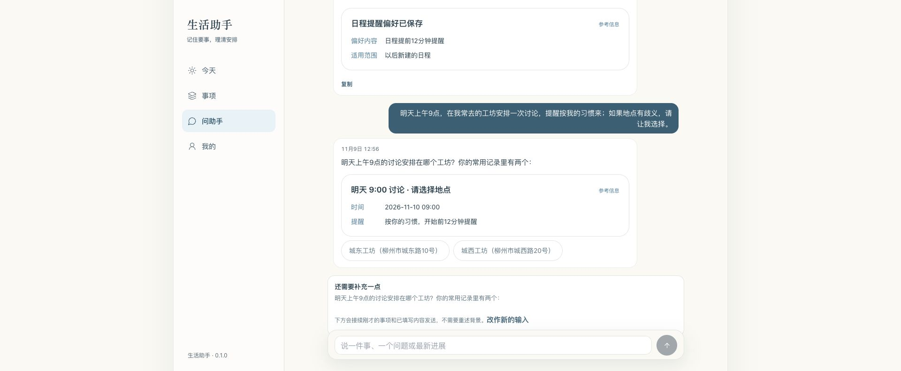
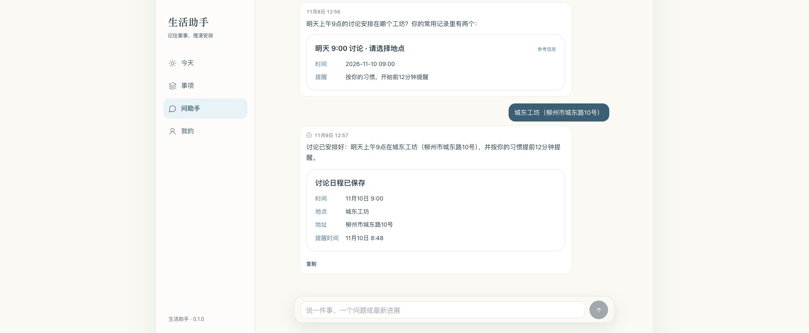

# 05 Agent、业务记忆与偏好应用

更新：2026-11-10。本文是 Assistant 业务记忆的当前规则；替代此前“长期正文由 Nexus 保存”“按用途开启及绑定角色”“事项来源自动限定使用范围”的方案。历史验证 JSON 保留为当时实现的记录，不作为当前运行说明。单 Agent 通信仍见 [27](27-接口复核与AI业务调用说明.md)。本次仅核对代码和已有证据、更新文档，没有重新调用模型或执行测试。

当前状态：独立存储、管理和受限业务工具已实现；重复来源、记忆管理/历史及日程详情问题已修复。常用开发库已完成 0028、独立密钥和旧记忆/历史导入。最近一次本会话运行核对（2026-11-10）实际使用 scripts/run_backend.py 统一管理原生 API、scheduler 和 worker，自动 AI 关闭；Docker 管理代码存在，不据此声称本机当前运行容器。本次未重新检查服务。秒数转带单位文字仍只有既有定向/启动证据，本次新增的是已保存时间和待办中文状态的浏览器证据。历史未启用、进程及环境描述只适用于其记录日期，服务器不从本机推断。

## 当前记忆应用覆盖（2026-11-10）

“记忆可被本次 AI 使用”与“业务接口逐字段校验并保存记忆来源”分别记录，不能统称为尚未实现的“扩展记忆应用”：

| 能力 | 当前状态与依据 | 确切剩余内容 |
| --- | --- | --- |
| 同账号跨通勤、事项、日程读取与修改记忆 | 已实现；来源事项不自动限定用途，2026-11-09 自有记忆真实验收已覆盖跨事项检索、纠正和遗忘 | 不重复开发一套通勤记忆或事项记忆库 |
| 首轮记忆用于已有业务工具 | 已实现；2026-11-10 Chrome 真实任务将记忆和会议查询结合，创建带截止及提醒的待办 | 该场景不等于所有业务参数都有逐字段来源回执，不等于已实现全天重排 |
| 独立日程、路线的 memory_defaults | 已实现；日程地点/开始时间/相对提醒及路线起终点/交通方式可选择来源，保存前复核；明确值与同字段记忆选择互斥 | 现有记录修改保留未传字段；不自动套用最新偏好 |
| 待办、组合草稿、长期通勤计划的逐字段来源 | 本次代码已补齐并通过隔离定向检查；包括普通组合草稿及通勤草稿→测算→周期计划，保存来源与实际业务写入在同一事务完成 | 2026-11-11 本机已备份、迁移 0029 并整组重启；服务器未处理，旧记录不补猜来源 |
| 明确重新应用、作息及相对截止依赖 | 本次已补待办/日程修改、组合草稿编辑及长期计划更新的显式记忆选择与新来源保存，原来源不覆盖 | 完整作息窗口和相对待办截止的自动重算依赖仍未实现；不自动因记忆变化改旧安排 |

代码定位：services/record_commands.py、services/memory_applications.py、services/commute_bundle.py、commute/services/plans.py。原独立日程和路线逻辑保留；本人记忆管理不变。后端按实际接口字段校验，不增加问题域 category 枚举，不要求用户设置用途或角色。

### 本次新增来源记录：实现、隐私与启用条件

提交范围：来源记录先以 a007643 提交，随后补交其直接接口衔接和必要依赖：待办/日程记忆参数、共享选择与业务引用结构、来源一致性校验、本地记忆读取/加密/写入锁、记忆表模型与会话装配、0028 登记及 cryptography 声明。同一次 Nexus 运行的工具回调、按需读取接口定义及账号和任务归属校验已进入 2026-11-12 的提交。2026-11-12 纳入首轮记忆检索、本人记忆管理接口及回答保存后由后台执行记忆修改。下文真实 AI 验收使用当时包含其他改动的完整工作区。本次提交未重新运行验收。

由 AI 按本次输入选择哪些记忆、业务字段和值；后端不判断语义适用性，只核对当前用户、本任务确实检索的条目、当前版本/状态、真实原文、字段类型/明确限制及重复来源。同字段普通值（含 null）与 memory_defaults 不能同时提交。修改接口只重新应用本次明确给出的选择，未传字段继续保留；长期 PUT 仍按原完整配置及 If-Match 执行。

来源是内部记录，不是新增页面内容：不增加前端来源入口或用户设置，不默认将记忆全文塞入回答。只有用户询问来源、需要澄清歧义或解释重要安排时，AI 才简短回答，确有必要可用卡片；只要文字仍不生成卡片。新的待办/长期计划来源不添加到普通页面响应；原日程 creation 回执兼容保留。后端不会根据文本词语猜测“是否有必要展示”。

| 接口 | 本次来源选择 |
| --- | --- |
| POST /todos、PATCH /todos/{todo_id} | due_at、reminder_at 的 memory_defaults；PATCH 保存 reapplication 历史，原 todo_id 不变 |
| POST /schedules、PATCH /schedules/{schedule_id} | location、starts_at、reminder_offset_seconds；修改只处理本次提交字段，原 ID/其他字段保留 |
| POST /matters/drafts、PATCH /matters/drafts/{draft_id} | schedule 和每条 todos 各自选择；确认时重新核对，实际保存后才按生成的真实 ID 记账；未保存/冲突不产生已采用来源 |
| POST /commute-plans、PUT /commute-plans/{plan_id} | origin/destination、transport_mode、星期、到达/检查时刻、余量、时区、生效日、天气余量/阈值和通知字段；仍校验完整周期配置 |
| POST /matters/commute-drafts、POST /matters/drafts/{draft_id}/commute-quote | 查询词/城市/到达时间/周期条件，以及测算 mode/首日/星期/余量；保留经后端签发的选点和真实测算流程，来源跨阶段保留到实际计划 |

以上均位于 /api/v1 下。每个选择仍用 entry_id/version/source_quote/value/reason；新增可选 references，最多 4 个真实业务对象，每个含 kind=schedule/todo/commute_plan、record_id、version。日程/待办引用所属 matter.version，通勤计划引用 revision；与外层记忆 version 是不同对象。后端读取并保存真实业务快照，不接收模型编造的快照。AI 提出计算结果，后端不解释原文或接管计算规划；记录“曾参考会议”不建立会议改期后自动重算依赖。

新增 business_memory_applications 表，正文复用现有独立记忆密钥加密；保存目标 ID/版本、creation/reapplication、记忆编号/版本/原文、AI 拟采用值/理由、经核对的业务引用及快照、实际采用值，明确重新应用时保留此前字段值。原来源和记忆版本不覆盖。草稿中的加密来源信封不发给页面；正式来源与原业务变更同事务提交，失败回滚，重复确认不重复记账。缺密钥明确失败，不创建替代密钥。

新增增量迁移标记 0029_business_memory_applications，由 scripts/migrate_sqlite.py 的 init/upgrade 创建缺失表；不回填猜测旧来源、不删除旧记录。隔离库定向检查完成后，2026-11-11 已按授权备份本机常用库至 `services/assistant-api/data/backups/before-0029-20261111-152748/local-development.db`，执行既有 upgrade 完成 0029，并经 `scripts/run_backend.py --env-file .env` 统一重启 API、scheduler 和 worker。健康端点 200、两个后台进程心跳已更新；3 个账号、5 个事项、4 条待办、1 条日程、3 条提醒、3 条记忆及其 3 条版本记录数量保持不变，配置和原记忆密钥未改动。自动 AI 关闭，Agent 记录仍为 16 条；本次未调用模型、未做额外测试、回归或哈希。服务器未在本次操作范围，不要求修改 Nexus。

定向验证：在 services/assistant-api 执行 `.venv/bin/python -m pytest tests/test_memory_application_records.py -q --tb=short --disable-warnings --maxfail=1`，7 项通过。覆盖真实隔离 SQL 的待办引用与重复/重应用、组合来源再次校验与确认/编辑、周期计划、通勤组合跨阶段、其他账号/未检索来源拒绝、固定 Agent 回调读后执行及增量迁移保留。此为固定 Agent 意图与离线地点/路线样本，不是真实模型/浏览器验收；未修改 Nexus、未调用模型/外部地图、未跑其他测试/回归/哈希。此前 11 月 10 日真实浏览器结果保持其原范围，不当作新接口已被真实 AI 验收。

### 2026-11-11 待办来源真实浏览器验收

Chrome 通过当前 Web 源码副本，对独立 Assistant/Nexus 数据库完成两轮真实任务，使用 opencode/glm-5.3-flash；每轮一个 Agent，共 6+1 次模型调用，无重试。首轮初始检索取得真实记忆“资料整理待办在相关会议前 30 分钟截止”，AI 按需获取定义、读取明天 10:00 的项目讨论会及事项版本，再以 memory_defaults.due_at 和会议 references 创建 09:30 截止的待办。加密来源行保留记忆版本 1、原文、AI 选择理由、会议版本/真实快照和实际采用值。普通保存响应不新增来源字段；终答 cards=[]，页面只显示结果，未展示记忆原文、内部编号或来源入口。

第二轮用户明确追问依据并允许卡片，AI 使用本次检索记忆与允许的执行历史解释会议时间减去 30 分钟，返回文字和一张信息卡片；页面字段、中文、时间均正常，无控制台错误或警告。未再调用写接口，最终只有 1 条待办和预置的 1 条日程。这不表示新增了来源读取工具，也不证明任意历史版本的来源都可由 AI 查询；组合草稿、周期计划和重新应用沿用前述隔离定向检查范围，本次未扩大验证。

[精简验收记录、实际字段与截图](evidence/memory-sources-browser-20261111.json)。原配置、记忆密钥和业务数据未改；自动 AI 关闭。临时存储使用本地 S3 协议样本，未验证真实对象存储部署。不运行额外测试、回归或哈希。

### 2026-11-10 已执行的浏览器联合验收

隔离账号已有明天 10:00 的“项目讨论会”和一条原文记忆：“我整理报销资料时，待办截止时间设在相关会议开始前30分钟，提醒时间比待办截止时间再提前10分钟。”

- 第一条消息：首轮提供 66 项简短索引，仅预载解析工具；AI 一次取得日程查询/详情和待办创建定义，实际查询会议、创建一条“会前整理报销资料”，截止 2026-11-11 09:30、提醒 09:20（Asia/Shanghai）。会议未修改，卡片显示“未完成”。6 次模型调用，其中两次终答卡片因常量/无效结果引用被拒绝，原 Agent 修正后完成，没有重复创建。
- 第二条消息：新 Agent 按需取得完成待办定义，将原待办保存为 done，3 次模型调用。模型和后端均返回 cards=[]；首次浏览器检查失败，Web 旧回执展示额外生成“本次结果”卡片。
- Web 随后修复空数组判断：非空数组展示指定卡片，[] 不展示，旧响应无卡片列表才继续使用回执。使用上述保存响应的三项定向检查及 Chrome 重开历史验证通过，修复验证新增模型调用为 0。提交为 Web worktree 的 d976590，未推送；其他已有改动保留。

两个用户任务分别保持一个 Nexus Run/workflow，共 9 次 opencode/glm-5.3-flash 调用，没有提供商重试。本次文档更新只读取已有记录。临时隔离进程已停止，原配置与业务数据保留。该验收使用本地 S3 协议存储夹具，不证明正常 MinIO 可用；没有调用地图/天气，未验证冲突场景、全天路线、秒数显示转换或通知送达。

证据：本机 /private/tmp/assistant-browser-acceptance-20261110/audit.json、first-result.png、second-result.png、cards-empty-fixed.png；公开合成响应与三个检查已保存在 Web 提交 d976590 的 apps/web/tests/fixtures/intake-card-responses.json 和 tests/api-operation-card.test.mjs。待办时间由 AI 读原文后计算并以普通参数提交；任务快照保留检索来源，但不能把该场景写成待办逐字段 memory_defaults 来源校验已通过，也没有保存“以后改会议自动重算此待办”的依赖。

## 职责与一次聊天的执行顺序

Assistant 保存账号、用户原文、业务记忆、权限与业务结果。Nexus 只接收本次需要的文字和工具说明，决定调用、追问、继续与终答；所有写入由 Assistant 执行。一个用户任务对应一个 Nexus Agent；工具调用正文、完整参数、summary 和实际结果追加至该运行。Assistant 不自行维护另一套模型循环，不调用 Nexus 原生记忆工具，也不把业务记忆同步写入 Nexus 平台记忆。

| 聊天位置 | 接口或动作 | 执行条件及等待策略 |
|---|---|---|
| 接收输入 | 保存用户原文及可信账号 | 在调用 AI 前完成；历史与 AI 文本分别标注来源 |
| 首轮启动前 | 一次本地记忆预取，复用 business-memory/query 的检索逻辑 | 有界扫描、时限及返回数量；失败、关闭、未命中与空库分别记录，不发第二个模型请求 |
| Agent 进行中 | recall_business_memory | 已给候选不足才补查；已确定空库不反复换词查询 |
| Agent 进行中 | 一级operation_index及resolve_operation_definitions | 首轮只给最多128项简要uri/summary/effect目录和解析工具。Nexus理解意图，按uri取得完整业务定义后自行决定是否调用；search只查目录，不自动展开参数或后续接口。后端不做否定句过滤；同一Agent保留已加载定义及共享结构，地图、天气不因目录或记忆检索自动调用 |
| Agent 修正与停止 | invalid_parameters 或日程 conflict_detected | 格式错误提供字段/格式修正要求；日程确认事务回滚成功才在 result.data.error.details 返回 formal_write_status=not_applied、真实 conflict/draft/target，并 failed/continue。原 Agent 决定调整或询问，保留先前成功步骤；无回滚依据的错误、超时及提交后丢失响应仍 unknown/stop，不换编号重写。既有临时 SQLite 定向通过；11 月 10 日原 Agent 卡片纠正已真实验证，日程冲突未触发，不能据此视为真实冲突场景通过 |
| 业务写入前 | memory_defaults 及来源复核 | AI 选择明确参数或记忆来源之一；同字段重复来源（包括 null）在写入前拒绝，不静默选择。校验账号、原文、当前条目版本、状态及明确限制。resolve_business_preferences 是可选提前校验，不必每次重复调用；正式写入仍检查 |
| 终答前 | mutate_business_memory，execution=before_answer | 用户要求立即保存/纠正/遗忘，或本轮安排依赖这次变更时使用；返回真实结果后模型才能声称成功 |
| 终答前，仅登记 | mutate_business_memory，execution=after_answer | 不影响本轮结果的候选整理；当前用户明确请求但无需即时确认的修改也可登记。返回 queued、applied=false，仅表示已排队。无明确删除意图不能遗忘有效条目；只是检索到目标不算业务依赖，不因此强制同步修改 |
| 终答持久化后 | Assistant 后台 worker 执行已登记的本地记忆命令 | 不再调用模型；未完成、失败或取消的聊天不执行待处理修改。这里指回答已保存可供客户端读取，不承诺网络已把回答送达屏幕 |
| 后续查询 | GET memory/operations/{operation_id} | 聊天结果和历史仅在产生记忆写入或登记后台操作后提供 `pending_context.memory_operation_ids`。Web 按编号查询处理状态和已保存版本。普通问答及纯业务调用不会触发回执查询 |

回答后的执行减少的是本地持久化工作的等待，不是把“生成记忆操作”的模型推理移到回答后。模型仍在原 Agent 生成意图并由 Assistant 登记。用户主动说“记住/忘记”且希望确认结果时默认当场完成，避免为了减少等待而返回假成功。自动整理只允许 propose 候选；不会把一次地点选择自动升为长期事实。后台执行失败保留错误供查询，不自动覆盖新版本、不自动重试未知写入。

## 存储、字段与加密

迁移 `0028_owned_memory` 新增四张表：

| 表 | 用途 |
|---|---|
| assistant_memory_scopes | 每账号的自动使用开关与 scope_revision |
| assistant_memory_entries | 当前记忆、归属、entry_version、状态及加密正文 |
| assistant_memory_versions | 不可改写的历史修订，遗忘和撤销也形成新版本 |
| assistant_memory_operations | 加密的完整请求、重复请求标识、执行结果和回答后待处理状态 |

记忆的业务范围开放，category/tags 均是可选文字；不规定固定文件名、场景包或领域列表。任意内容可用 text；可准确表示时使用与 Nexus 兼容的 place、commute_preference、time_preference、experience，以及 app_data。四种结构是数据格式，不是用户问题域的枚举。电动自行车等尚不属于原 commute_preference 格式的值可保存在开放 business_value 中，不冒充原格式已支持。

- entry_id：稳定条目编号；user_id 只由服务端账号确定，不作为 AI 输入参数。
- entry_version：条目修改条件。兼容管理接口保留同义 version，AI 修改使用 expected_entry_version；旧 memory_defaults 中 version 仍指同一个条目修订号。
- scope_revision：账号设置及写入序列，AI 工具不接收，不用于条目修改。管理设置的旧 expected_version 对应它。
- schema_version：格式版本，不用于防止并发覆盖。
- status：candidate、active、forgotten。自动检索只返回 active；遗忘保留历史供本人管理/撤销，不等于物理抹除所有副本。
- text、typed_data、app_data：原文和可选结构；app_data.fields 保持 8192 字节及深度限制，不接受身份、开关和权限字段。
- source：source_quote、local_run_id、nexus_run_id、来源 matter_id、text_origin、proposed_by、executed_by；原文与模型改写明确区分，纠正保留最初来源，历史保留每次来源。
- 来源 matter_id 只是发生位置。默认同一账号在通勤、事项、日程均可读取和修改同一条记忆；只有用户明确限定时才写 applicability，不自动限制到来源事项。

正文、结构、原文引用和完整修改请求使用 AES-GCM 加密后保存在 Assistant 数据库。账号标识作为认证附加数据，随机 nonce 每次生成；这不是内容哈希。元数据和不含正文的执行结果可查询。配置 `ASSISTANT_MEMORY_ENCRYPTION_KEY_PATH` 指向独立的 32 字节 base64 密钥文件；不能用 Nexus token 或现有业务密钥代替，丢失密钥不能解密。密钥与数据库须私密备份，当前不自动轮换。检索时 Assistant 解密必要内容交给本次 Agent；加密字段不能直接 grep。这项加密不改变既有聊天记录及任务快照的存储方式；本次交给 Agent 的必要明文仍会出现在相应聊天上下文和审计记录中。

## 对外接口

本人管理继续兼容现有客户端，无需已有 Nexus Run：

| 方法与路径 | 字段与结果 |
|---|---|
| GET /api/v1/memory | offset、limit、可选 local_run_id；返回当前条目及版本、状态、正文、来源和 business 投影 |
| GET /api/v1/memory/settings | 返回 enabled、scope_revision 及兼容 version；不调用 Nexus |
| GET /api/v1/memory/history/{entry_id} | 返回本账号 current_version、历史 items 及分页；他人编号返回 404 |
| POST /api/v1/memory/commands | action、key；save/propose/correct 需要 text；correct/forget/confirm/undo 需要 entry_id、expected_version；settings 需要 expected_version、enabled。保留 typed_data、app_data 与本人确认字段的输入兼容 |
| GET /api/v1/memory/operations/{operation_id} | 查询本账号一笔记忆操作的 `status`、`result`、`error_code` 和 `can_undo`。存在上一版本且已应用版本仍为当前版本时允许撤销 |

旧 disclose 动作不再写 Nexus 授权；返回 memory_disclosure_not_required，客户端无需为 Assistant 自有记忆走平台披露流程。模型不能调用本人管理接口修改总开关或伪造本人确认。旧 POST /api/v1/memory/search 读取本地记忆，保留旧搜索返回格式。

AI 可用接口由当前 FastAPI OpenAPI 自动提供，无需 Nexus 增加静态业务分支：

1. POST `/api/v1/business-memory/query`，operation_id=`recall_business_memory`。purpose 为开放任务说明，query/queries 为查询表达，mode=search/browse，categories/tags 只排序，matter_id 必须有权限，offset/limit 有界。返回原文、typed_data、business、entry_version、兼容 version、provenance、source、coverage、match_status 和继续检索建议。字面检索不是语义搜索；无匹配不等于没有记忆。
2. POST `/api/v1/business-memory/commands`，operation_id=`mutate_business_memory`。action=save/propose/correct/forget，source_quote 必须逐字来自当前可信用户消息；text 是拟保存正文（save/propose 省略时采用 source_quote，correct 必须提供完整新正文）；intent=user_requested/incidental；execution=before_answer/after_answer；修改或遗忘需 entry_id、expected_entry_version；可附 app_data、typed_data。身份、总开关、确认权限和请求去重标识都由服务端控制。模型理解持久意图，不依赖“记住”这几个固定词；意图仍是模型判断，后端校验不能证明自然语言理解一定正确。
3. POST `/api/v1/business-memory/facts`，operation_id=`save_business_memory_fact`。保留旧原话保存工具，实际转为上述本地执行器；不再转发 Nexus。

示例：

```json
{"action":"correct","entry_id":"实际检索得到的编号","expected_entry_version":2,"source_quote":"以后通勤改成公交，事项出行也一样","text":"通勤和事项出行默认公交。","intent":"user_requested","execution":"before_answer"}
```

返回实际 entry_id、entry_version、version、status、applied_version。相同 key 和完整参数只写一次；同 key 不同参数拒绝。重放的 version 可为当前版本，applied_version 保留原操作真正生效的版本。correct 省略或传 null 的 typed_data/app_data 延续旧格式的“保留”，不解释为清空。undo 产生新的递增版本，不把版本号倒退。

## 失败、迁移与启动

- 记忆密钥或正文不可读返回明确 503，不伪装空库；关闭自动使用仍允许本人管理。
- 版本或重复标识冲突返回 409，其他账号条目返回 404；模型在同 Agent 重读后决定，不强制覆盖。
- 待处理状态：awaiting_answer → ready → succeeded/failed；取消或失败任务的待处理项变 cancelled。数据库事务保证重复 worker 不重复生效。失败无自动重试，用户可重新读取后决定新的操作。
- 本次实际采用的来源仍写入原 MatterDraft/MatterChange、任务快照及执行记录，不复制一份独立可编辑的“任务记忆”。

启用顺序：私密备份现有 SQLite 和配置 → 使用 scripts/configure_memory.py 创建独立密钥 → 在部署配置加入密钥路径 → 执行 scripts/migrate_sqlite.py upgrade 加表 → 暂停迁移账号写入，用 scripts/import_owned_memory.py --user-id ... 先预览，再 --apply 导入 → 确认来源后重启 Assistant API 和后台 worker。导入按原编号、历史修订、状态和设置保留，记录 Nexus 来源；目标非空、历史不完整或源版本变化则停止。导入前再次做 SQLite 备份。旧 Nexus 记忆不删除、不双写；旧平台操作审计留在来源，不宣称已经转入本地。不要从任务快照猜测完整长期记忆库。

上述操作本轮仅在隔离数据中验证，尚未应用至常用开发库或服务器。普通业务服务保持原状；未安装依赖、未运行额外回归、未做哈希检查。Assistant 声明的工作流总预算也传到 Nexus 已支持的角色 timeout_seconds，避免原生默认 60 秒先耗尽整个工具循环；不修改 Nexus 实现。

## 2026-11-09：自有记忆实现验收（历史环境）

当时后端实现与隔离记忆验收已完成，常用服务尚未启用；后续本机迁移和当前覆盖见本文开头，不再作为待办。[完整输入、模型正文、接口参数、执行结果、历史与数据库核对](evidence/owned-memory-20261109.json)。

| 验收要求 | 结果与实际依据 |
|---|---|
| Assistant 管理记忆 | 通过；独立 SQLite 有 active/forgotten/candidate 三条，隔离 Nexus user_memory_entries 为 0 |
| CRUD 接口及字段 | 通过；本人管理、历史、设置、版本/重复请求与其他账号拒绝在 8 项定向检查中通过；真实模型新增/检索/纠正/遗忘均返回实际结果 |
| Nexus 理解工具说明 | 通过；从 Assistant OpenAPI 取得定义，没有新增 Nexus 静态业务名称 |
| Nexus 按提示提出操作 | 通过；真实 opencode/glm-5.3-flash 产生 memory 查询、save/correct/forget/propose 参数和最终 answer |
| Assistant 解析并分派 | 通过；正式 App 正文回调执行同一个业务路由，完整参数、summary 和结果保存；只兼容工具 JSON 的单层代码围栏，不猜参数、不修复损坏 JSON，终答仍要求原始 JSON |
| 本地字段与历史保存 | 通过；同一条目 v1 步行改为 v2 公交，保留 12 分钟提醒、用户原话及通勤来源；另一个实际事项按其编号读取到同一条目；临时条目 v2 forgotten |
| 完整记忆流程及回答后处理 | 通过；1 个 Nexus Run、1 个 workflow、8 次模型调用，7 次工具执行及终答。回答中候选仅已入队；一次实际 Assistant background.tick 后成为 candidate，仍不参与自动使用，后台增加模型调用 0 次 |

定向命令：`.venv/bin/python -m pytest tests/test_owned_memory.py -q --tb=short --disable-warnings --maxfail=1`，8 passed（最后一次检查包含“已检索但未实际采用的条目仍可登记回答后修改”）。包含真实 SQLite 的增量迁移/原账号保留、完整历史导入、并发版本冲突、队列恢复与冲突、缺密钥错误、混合数字中文检索、同 Agent 已提供定义保留及日程实际来源保存；没有运行其他回归套件。

最终真实输入围绕同一通勤/事项记忆的保存、纠正、读取、临时条目遗忘和回答后候选登记。长期记忆结果为“通勤和事项出行默认公交，日程提前12分钟提醒。”，version/entry_version=2；原始通勤事项来源保留。原模型终答先说候选仅排队，后台执行后才是已保存 candidate，不把建议说成有效偏好。

前期探索不是通过记录：首次暴露缺省正文校验，随后发现 60 秒角色总时限、供应商流式 network_error、工具代码围栏以及后一次接口检索清除旧定义等问题。已在 Assistant 处理必要兼容、反馈和预算；含日程新建的早期复合任务曾因调用上限失败，未计入最终记忆验收，也不宣称复杂日程组合已完成真实验收。所有尝试共 51 次模型请求尝试，最终通过场景为其中 8 次；失败记录与预算均保留，没有隐藏重试或拼成一个成功 Run。

隔离 API、Worker 与 Assistant 临时服务均已停止。正常 Nexus 8000（PID 70705）、Assistant 8010（PID 39466）保持原进程，未迁移常用数据库、未修改现有配置、未启用自动 AI。旧转发实现的历史测试文件本轮未运行，其通过记录不等于新存储验收。

既有偏好业务保持：独立日程采用本次 AI 选择的地点/时间/相对提醒，路线测算采用明确选择的起终点/交通方式；不要求用户设置用途或角色。完整出行重新规划、下一步行动中心、跨事项相对截止及前端记忆管理更新仍是后续事项。2026-11-09 早先浏览器实验的来源和卡片限制见 [记录](evidence/preference-live-20261109.json)，不是本轮独立记忆的验收结果。


## 2026-11-09：真实浏览器 AI 与操作体验验收

**结论：核心用户任务已跑通，完整验收未全通过。** 当前 Web 工作区源码副本连接最新 Assistant；使用真实 Chrome、独立 Nexus/Assistant SQLite、未修改 Nexus App/Worker 实现。正常 3001/8010/8000 服务和原账号、配置、数据不变。没有修改产品源代码、安装依赖、调用地图天气、执行共享或发出系统通知。没有额外测试套件、回归或哈希检查。

本轮 4 个用户输入分别在一个 Agent 中完成，共 12 次 opencode/glm-5.3-flash 模型请求，供应商重试为 0；2 次结果卡片提案校验失败后在原 Agent 修正，未重新执行业务写入。每个输入的后端处理时间约 10.57、10.55、40.82、20.21 秒，不是性能基准。完整字段、模型原文、执行结果和发现见 [本轮机器记录](evidence/browser-memory-20261109.json)。

两条工坊地点是本轮预置样例，不是真实账号的生活资料或模型凭空生成的地点。提醒记忆通过浏览器由 AI 实际创建和纠正。

### 操作步骤与页面证据

| 步骤 | 用户操作 | 健康情况 | 当前截图 |
|---|---|---|---|
| 1 | 问助手进入登录 | 可登录；成功后跳今天，丢失原入口 | [入口](evidence/browser-memory-20261109/01-start.jpg)、[登录后](evidence/browser-memory-20261109/02-login-lands-today.jpg) |
| 2 | 输入“请记住：我的日程习惯提前12分钟提醒。” | 通过，真实保存及卡片反馈 | [等待](evidence/browser-memory-20261109/03-saving-memory.jpg)、[成功](evidence/browser-memory-20261109/04-memory-saved.jpg) |
| 3 | 交代明天9点在常去工坊讨论，地点不明确先选择 | 通过，先追问，尚未创建日程；选项在卡片下方 | [问题与选项](evidence/browser-memory-20261109/05-place-choice.jpg) |
| 4 | 点击城东工坊 | 保存恰好1个日程/提醒；来源分类不通过 | [实际结果](evidence/browser-memory-20261109/06-schedule-created.jpg) |
| 5 | 输入“把我的日程提醒习惯改成提前15分钟，已经创建的日程保持不变。” | 通过，同条记忆v2，旧日程不变 | [纠正结果](evidence/browser-memory-20261109/07-preference-corrected.jpg) |
| 6 | 我的→个人记忆 | 当前内容与版本通过；指令404、旧Nexus说明不通过 | [入口路径](evidence/browser-memory-20261109/08-memory-entry-path.jpg)、[管理页](evidence/browser-memory-20261109/09-memory-management.jpg) |
| 7 | 查看历史 | 原文/修改后正文均保留；历史标题和关闭位置有问题 | [打开时实际视口](evidence/browser-memory-20261109/10-memory-history.jpg) |
| 8 | 事项→讨论→详情 | 已保存的地点/时间/提醒正确；系统文案与可选路线增加负担 | [列表](evidence/browser-memory-20261109/11-created-matter-list.jpg)、[详情](evidence/browser-memory-20261109/12-saved-schedule-detail.jpg) |

日程为 **2026-11-10 09:00（Asia/Shanghai）**，城东工坊，提醒 **08:48**；未擅自填写结束时间。记忆改到15分钟后，此日程和提醒的编号、时间未改变。选择消息的 parent_run_id 正确指向追问任务，不要求重述背景。Nexus 平台记忆条目为0，Assistant 中为2条地点样例和1条v2提醒记忆。

### 必须修复及交互建议

1. **B01 / P1，来源分类**：AI 同时传 `reminder_offset_seconds=-720` 和同字段的 `memory_defaults`。记忆编号/原文仍保留，但后端记录 `source=request/status=preserved/reason=explicit_value`，没有作为实际采用记忆处理。当前用户的选择消息没有给出12分钟，不能仅靠调用字段存在就把它当本次明确值。应避免模型双重提交，并在服务端区别用户明确值与 AI 从记忆转换的值。数值正确不等于来源验收通过。
2. **B02 / P1，管理页接口和说明**：自动读取 `/api/pa/memory/instructions` 实际404，页面显示“请求未能完成”；仍说Nexus控制记忆自动使用并显示共享入口。应与Assistant自有记忆职责一致，未支持的功能不提供可执行操作。本轮未执行共享，不把未经授权的共享作为测试步骤。
3. **B03 / P2，成功后的下一步**：回复卡片只有复制，不能直接打开日程或记忆；目前需去事项/我的再次查找。建议使用真实编号提供“打开日程/查看记忆”，不让用户重新描述。
4. **B04 / P2，等待和控制**：点击地点到结果本次处理约41秒，主要只有“正在理解/回复”。当前新流程没有可见取消入口；卡片格式错误额外花费2次调用。建议提供用户能理解的阶段和取消/未知结果说明，减少卡片协议重试，不重做已保存业务。
5. **B05 / P2，追问重复**：问题在回答和输入区上方重复，接续说明较长。保留一处完整问题、卡片下方选项和简短接续状态即可。选项是原生按钮、高44px、tabIndex=0，本轮可点击且能防止处理中的重复点击。
6. **B06 / P2，历史和作者**：后端保存 user_quote/model_rewrite 及原话，页面只列内容/版本，未告诉用户哪段是原话、哪段由助手整理。历史展开在列表上方，标题和关闭操作可能位于当前视口外。建议明确当前/修改前、作者与时间，打开时处理滚动和焦点。
7. **B07 / P2，详情负担及系统文案**：仅安排讨论也突出“出发地待补充/出行方式待确认/时间未定”，容易让用户认为保存未完成。路线应为可选后续动作，说明未定的是出发时间。列表“结构化业务请求”、重复“提醒：提醒”、没有待办却写“提醒随待办时间一并更新”均需用实际业务对象描述。
8. **B08 / P2，登录接续**：保存返回地址及未发送内容，登录后回到发起任务的页面。





本轮仅验收默认桌面 Chrome 窗口；未做窄屏、完整键盘或读屏验收，不能据截图宣称无障碍合规。没有验证到点通知送达，也不把日程提醒保存等同于推送成功。以上问题本轮只记录，没有实施修复；后续优先处理 B01、B02 后再复验。隔离浏览器标签及临时服务已关闭，证据和数据保留；正常 3001/8000/8010 仍为原进程。
